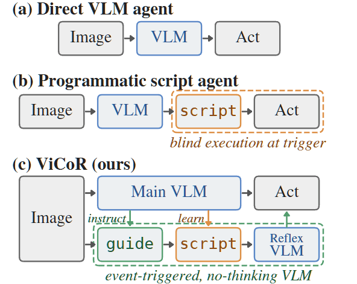

<div align="center">

# Acting by Intent, Reacting by Sight:<br>Visual Conditioned Reflexes for Real-Time VLM Agents

**Qiancheng Zhou**, **Wenhua Zhang\***

<sub>\*Corresponding author</sub>

[](#citation)
[](LICENSE)
[](pyproject.toml)

<br>

<picture>
  <source media="(prefers-color-scheme: dark)" srcset="assets/overview-dark.png">
  <source media="(prefers-color-scheme: light)" srcset="assets/overview-light.png">
  
</picture>

</div>

## Overview

Acting in a changing world requires both deliberate control for exploration and rapid responses to approaching obstacles or shifting landing platforms. Direct VLM control spends seconds deliberating over each action (`a`), whereas generated scripts (`b`) reduce this delay by committing the agent to encoded responses that can trigger the wrong action when a visual distractor appears or the scene changes before the model looks again.

**ViCoR** (**Vi**sual **Co**nditioned **R**eflex, `c`) bridges deliberate intent and sight-conditioned reaction with fixed model weights:

- **Deliberate Main VLM**: Explores the environment, plans long-horizon behavior, maintains structured visual memory (`GUIDE.md` and `WORKING.md`), and decides which recurring real-time situations to offload.
- **Visual Trigger & Distilled Guidance**: Binds each reflex to a lightweight visual event detector (`script`) paired with concise situational guidance (`guide`) and optional reference crops distilled from experience.
- **Sight-Conditioned Fast Branch**: When the detector fires, a fast no-thinking branch of the same VLM reads `guide` together with a motion-annotated local view to select an action—or abstain via `NONE` when a visual cue is a distractor.
- **Online Practice & Revision**: The main VLM inspects execution receipts and visual outcomes across turns and episodes, progressively refining triggers and guidance during interaction.

### Empirical Highlights

- **80.4% Mean Normalized Progress** across 17 [GameWorld](https://github.com/gameworld-project/GameWorld) tasks (**74.6%** at low effort), up from **61.8%** for programmatic scripts and **66.5%** for [VISTA](https://arxiv.org/abs/2610.02200).
- **15.4× Faster Reflex Dispatch**: In paired high-effort runs, reflex calls average **1.67 s** compared with main-VLM deliberation while handling **78.2%** of dispatched action events.
- **Continual Online Improvement & Visual Abstention**: Lifts five-episode *Doodle Jump* scores from **107** to **446** at low effort, and returns `NONE` on **41.0%** of triggers in *Wolfenstein 3D*.

## Agent Paradigms

All three paradigms illustrated above share the same environment observation stream, action arbiter, and VLM client:

| CLI Flag | Paradigm | Description |
| :--- | :--- | :--- |
| `--mode full` | **ViCoR (ours)** | Main VLM instructs `guide` and learns `script`, invoking an event-triggered, no-thinking Reflex VLM on motion-annotated views |
| `--mode pure-python` | **Programmatic script** | Main VLM writes `script` triggers whose encoded actions execute directly at trigger time without visual re-verification |
| `--mode pure-vlm` | **Direct VLM** | Main VLM perceives and acts directly on every step without offloading to a reflex branch |

## Installation

### 1. Install `vicor`

```bash
git clone https://github.com/ershiyidian/ViCoR.git
cd ViCoR

python3 -m venv .venv
source .venv/bin/activate
pip install -e .
```

### 2. Set Up Benchmarks

ViCoR uses a unified runtime interface across five real-time, interactive, and embodied benchmark suites. Run the setup script for the benchmark(s) you wish to evaluate:

```bash
# Required base runtime + 17 HTML5 real-time & action games (GameWorld)
bash scripts/env_setup/gameworld.sh

# Optional cross-domain benchmarks
bash scripts/env_setup/aigamestore.sh     # AI GameStore interactive web games
bash scripts/env_setup/omnigamearena.sh   # OmniGameArena 2D/3D Unreal Engine 5 tasks
bash scripts/env_setup/arc3.sh            # ARC-AGI-3 interactive reasoning games
bash scripts/env_setup/robodojo.sh        # RoboDojo Isaac Sim tabletop manipulation
```

Verify available tasks across installed catalogs:

```bash
vicor list-tasks --benchmark all
```

## Quick Start

ViCoR connects to any OpenAI-compatible Chat Completions endpoint (such as vLLM, SGLang, or llama.cpp). You can point both branches at the same endpoint or assign dedicated GPUs to `--endpoint` (main VLM) and `--reflex-endpoint` (fast no-thinking branch).

### Run ViCoR on GameWorld

```bash
# Single-episode evaluation (real-time clock continues during VLM deliberation)
vicor run \
  --game 10_doodle-jump \
  --task 10_01 \
  --mode full \
  --endpoint http://127.0.0.1:8000/v1/chat/completions \
  --reflex-endpoint http://127.0.0.1:8001/v1/chat/completions \
  --model Qwen3-VL-30B-A3B \
  --effort low \
  --episodes 5 \
  --max-steps 400 \
  --seed 1800 \
  --output runs/doodle_jump_vicor
```

### Run Cross-Domain Benchmarks

```bash
# OmniGameArena (3D / 2D UE5 environments)
vicor run --game oga_obstacle_run_2d --task oga_01 --mode full --output runs/oga_run2d

# AI GameStore
vicor run --game aigamestore_game1 --task aigs_01 --mode full --output runs/aigs_game1

# ARC-AGI-3
vicor run --game arc3_ls20 --task arc3_11 --mode full --pause-during-inference --output runs/arc3_ls20

# RoboDojo (Isaac Sim robotic manipulation)
vicor run --game robodojo_push_T --task rd_01 --mode full --output runs/robodojo_push_t
```

Each run writes structured telemetry and artifacts under `--output`:

- `summary.json`: Episode outcomes, step counts, reflex dispatch share, `NONE` abstention counts, and latency distributions (`model_seconds` vs. `reflex_seconds`).
- `episode_XX/summary.json`: Per-episode official benchmark metrics and terminal status.
- `events.jsonl` & `evaluations.jsonl`: Full timestamped trace of frames, triggers, reflex perceptions, and executed actions.
- `library/`: Learned visual trigger scripts, bound reference crops, and distilled `guide` cards.

## Repository Structure

```text
ViCoR/
├── assets/                          # Light/dark transparent paradigm overview figures
├── scripts/
│   ├── env_setup/                   # Per-benchmark installation & overlay setup scripts
│   └── eval/                        # Convenience evaluation wrapper
└── src/vicor/
    ├── cli.py                       # `vicor` CLI (`run`, `list-tasks`, `install-overlays`)
    ├── core/
    │   ├── vista_reflex.py          # Main VLM session, visual history & reflex tool bindings
    │   ├── coordinator.py           # Concurrent observation, main-VLM, reflex & evaluator loop
    │   ├── visual_reflex.py         # Event-triggered sandbox & motion-annotated Reflex VLM engine
    │   ├── trigger_template.py      # Built-in visual template & motion detector primitives
    │   ├── actions.py               # Priority-aware real-time input & lease arbiter
    │   ├── streams.py               # Continuous frame capture ring buffer & event ledger
    │   └── prompts/reflex_rules.md  # Main-VLM reflex authoring contract
    ├── backends/                    # Async OpenAI-compatible & Responses API model clients
    ├── vista_runtime/               # Vendored MIT visual-memory & note-keeping contracts
    └── benchmarks/
        ├── seeded_env.py            # Deterministic episode seeding wrapper
        ├── overlay_installer.py     # Multi-benchmark GameWorld adapter installer
        ├── overlays/                # Adapters & catalogs for GameWorld, AIGS, OGA, ARC-3, RoboDojo
        └── robodojo/                # HTTP simulation bridge for RoboDojo / Isaac Sim
```

## Citation

```bibtex
@article{zhou2026vicor,
  title   = {Acting by Intent, Reacting by Sight: Visual Conditioned Reflexes for Real-Time VLM Agents},
  author  = {Zhou, Qiancheng and Zhang, Wenhua},
  year    = {2026},
  note    = {Preprint}
}
```

## Acknowledgements

ViCoR builds upon the visual-memory runtime contracts of [VISTA](https://arxiv.org/abs/2610.02200) and evaluates across [GameWorld](https://github.com/gameworld-project/GameWorld), [AI GameStore](https://github.com/lance-ying/aigamestore_harness), [OmniGameArena](https://mxlin043.github.io/OmniGameArena/), [ARC-AGI-3](https://arcprize.org/competitions/2026/arc-agi-3), and RoboDojo. We thank their authors for open-sourcing their environments and tools.
